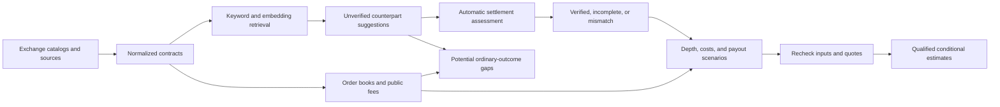

# Arbbot

**Prediction-market discovery and settlement-aware opportunity analysis.**

Arbbot continuously discovers prediction-market contracts, finds possible counterparts across venues, compares their settlement terms, and evaluates price gaps against current order-book depth and supported costs.

The product connects exchange ingestion, matching, settlement assessment, opportunity calculations, durable history, and a live web interface in one full-stack application.

> **Project status: active prototype.** The local simulation and recorded-data demos are ready to explore.
> Authentic contracts can be discovered and assessed across several categories, but settlement coverage remains incomplete and no real profitable opportunity is claimed.
> Production hosting and operations are still in progress.

[Quick start](#run-the-demo) · [Features](#what-it-does) · [Current status](#what-is-ready-and-what-is-still-wip) · [Development](#development) · [System design](docs/system-design.md)


*The screenshot uses recorded development fixtures. Prices, contract pairings, and review badges are illustrative; they are not live findings or proof of settlement equivalence.*

## What it does

- **Discovers markets across categories.** Browse politics, economics, sports, other, and uncategorized markets from the supported Kalshi and Polymarket US integrations.
- **Finds possible counterparts.** Hybrid keyword and local embedding retrieval proposes cross-venue pairs; exchange categories and similar titles do not prove that contracts settle the same way.
- **Makes uncertainty visible.** When Jev is configured, fresh event suggestions appear as Unverified regardless of model score. Automatic settlement checks determine whether a comparison is Verified, incomplete, or a Mismatch.
- **Separates price gaps from qualified estimates.** Potential results show ordinary-outcome gaps with unresolved assumptions. Qualified results require current supported settlement evidence, fees, order constraints, and quote rechecks.
- **Explains each result.** Inspect the original terms, source evidence, model findings, assessment history, freshness, liquidity, blockers, and calculation assumptions.
- **Keeps a durable record.** PostgreSQL stores source versions, quotes, model runs, assessments, and result history so calculations can be inspected and reproduced.

The system uses Jev through OpenRouter's Decisions API for bounded pair assessment when configured.
The model can suggest an event relationship, outcome orientation, and clause findings grounded in supplied evidence.
Python rules retain authority over settlement verification, financial calculations, and publication.
No Gemini extraction stage is required.

Arbbot estimates conditional opportunities. It does not place orders, hold funds, or transfer money.
An estimate does not guarantee an exchange will accept or fill both legs.

## How a discovery becomes an estimate



**Potential** and **Qualified** are separate result feeds.
A Potential result may assume complementary ordinary outcomes while exceptional settlement, fees, or other financial inputs remain unknown.
Unknown values stay unknown rather than being treated as zero.
A Qualified estimate requires current compatible settlement evidence and positive modeled worst-case net value after supported costs.

## Run the demo

Install Docker with Compose, then run from the repository root:

```sh
docker compose up --build -d
```

Open [Discoveries](http://localhost:3000/markets), [Opportunities](http://localhost:3000/opportunities), or the [interactive API docs](http://localhost:8000/docs).
The default stack starts PostgreSQL, migrations, the API, a background worker, and the web interface in **simulation mode**.
Its clearly labeled synthetic markets provide a reproducible calculation without exchange or model-provider credentials.
Open [All markets](http://localhost:3000/markets?view=all) to see the underlying simulation contracts.
The screenshot above uses a separate recorded fixture dataset.

To check the simulation after the worker has completed its first cycle:

```sh
docker compose exec -T api python scripts/smoke.py
```

Stop the local stack with `docker compose down`.
The default development ports bind to localhost, and database data remains in a Docker volume.

### Optional live public-data demo

A separate local configuration polls public Kalshi and Polymarket US market data.
It uses a separate database volume and can take a few minutes to build and populate.
Run only one local web/API stack at a time because both use ports 3000 and 8000.

```sh
docker compose -p arbbot-demo --env-file infra/demo.env up --build -d
```

This demo needs no private exchange account.
It does not fall back to synthetic data, so a venue outage, empty book, or stale quote remains visible.
It may show no Qualified estimates while evidence coverage is incomplete; that is an expected result.
See the [development guide](docs/development.md) for setup, stopping the demo, provider configuration, and live-data limitations.

## What is ready and what is still WIP

| Area | Current status |
| --- | --- |
| Full-stack workflow | Implemented across persistent ingestion, PostgreSQL, FastAPI, and Next.js. |
| Contract discovery | Kalshi and Polymarket US, with broad category traversal and cross-venue retrieval. Coverage depends on each venue's catalog, monitoring budget, and available evidence. |
| Matching suggestions | Fresh Jev same-event suggestions are visible as Unverified without a model-score cutoff. Model scores help rank and explain suggestions. |
| Settlement verification | Automatic checks expose Verified, incomplete, and Mismatch states. **Authentic applicability and exceptional-settlement coverage are WIP.** |
| Potential results | Implemented for depth-supported ordinary-outcome price gaps; unresolved settlement and cost assumptions remain explicit. |
| Qualified estimates | Implemented for pairs whose evidence, supported payout scenarios, fees, constraints, and fresh quotes pass current checks. **No real qualified opportunity is claimed by the current validation.** |
| Additional venues | A separate Polymarket International adapter and research identity exist. It is outside the current US demo and must not be confused with Polymarket US. |
| Production operations | **WIP.** Hosted identity-provider setup, public deployment, measured service levels, monitoring/alerts, and backup/restore rehearsal remain. |
| Open-source release | **WIP.** The repository does not currently include a license. Choose one before inviting reuse or outside contributions. |
| Trading | Out of scope. No automatic execution, custody, or fund transfers. |

The authentic broad-discovery sample contains 31 recorded contracts across politics, economics, sports, and other, with 22 source-reading pair labels.
On that sample, keyword and hybrid retrieval each found all 11 labeled event counterparts, so it showed no additional recall from embeddings.
The actual 22-response Jev run agreed with 22 event labels and 18 outcome-orientation labels.
This small sample does not establish general accuracy, settlement equivalence, production coverage, or profitability.
See the [benchmark record](docs/contributing/discovery-benchmark-2026-10-15.json), [corpus notes](backend/tests/fixtures/discovery_broad/README.md), and [acceptance record](docs/contributing/broad-discovery-acceptance-2026-10-15.json) for scope and limitations.

### Is it ready to be public?

**Yes, for a public presentation as an experimental prototype.** The repository has a reproducible simulation, an optional local public-data demo, a working discovery-to-results interface, and documented evidence boundaries.
A public repository can invite people to inspect and discuss the project, but this repository has no license yet, so do not invite reuse or outside contributions until you choose one.

**No, as a public production service or a tool to rely on for trades.** The application has not completed authentic settlement coverage, hosted identity and browser-session integration, provider spending controls, production monitoring, or backup and recovery exercises.
The optional Jev provider has a shared request-rate limit but no daily spending cap.
Do not expose a provider key in a public deployment without first adding and verifying usage limits and operational controls.
Live market availability and the small recorded benchmark do not establish executable or risk-free arbitrage.

For a public presentation, label simulation and recorded data at the point of use, identify the live-data demo as experimental, and keep result language conditional.
Do not advertise historical fixture estimates as live performance.

## Architecture

Arbbot is a modular monolith in one repository, with three separately runnable processes:

- **Web:** Next.js, React, and TypeScript, with responsive discovery, comparison, and opportunity screens.
- **API:** FastAPI and Pydantic for validated market, assessment, opportunity, history, and health endpoints.
- **Worker:** Python `asyncio` tasks for discovery, source capture, matching, fees, order books, and evaluation.

PostgreSQL is the durable source of truth, with SQLAlchemy models and Alembic migrations.
Server-Sent Events notify the browser when stored results change.
The API generates the TypeScript client from OpenAPI, and financial values use exact decimal strings at the API boundary.
A PostgreSQL advisory lock currently allows one active ingestion worker per database.
Redis and distributed workers are not part of the current deployment model.

| Layer | Main technologies |
| --- | --- |
| Web and UI | Next.js, React, TypeScript, Tailwind CSS, accessible UI primitives |
| Browser data | TanStack Query, TanStack Table, generated API client, Server-Sent Events |
| API and workers | Python, FastAPI, Pydantic, `asyncio`, HTTPX, WebSocket clients |
| Persistence | PostgreSQL, SQLAlchemy, Alembic |
| Local infrastructure | Docker Compose |
| Validation | pytest, Vitest, Playwright, recorded exchange and provider responses |

## Development

See the [development guide](docs/development.md) for Python and frontend setup, local services, migrations, tests, generated contracts, and recorded acceptance workflows.

Useful project references:

- [System design](docs/system-design.md) for data flow, boundaries, and scaling constraints.
- [Automatic qualification](docs/automatic-qualification.md) for verification rules and result feeds.
- [Jev classification](docs/jev-classification.md) for model inputs, evidence, provider behavior, and benchmarks.
- [Broad discovery handoff](docs/contributing/broad-discovery-handoff.md) for this milestone's checks and the next engineering action.
- [Contributing guide](CONTRIBUTING.md) for repository conventions.

## Latest recorded checks

The broad-discovery implementation passed 576 backend tests on SQLite and 576 on PostgreSQL, 66 frontend unit tests, and 70 desktop/mobile fixture browser tests.
Connected PostgreSQL, worker, API, and production web acceptance passed on desktop and mobile.
The production web build, backend container build, TypeScript checks, lint, generated API client check, and Python lint/format checks passed.
These are local recorded checks for the implementation commit, not a hosted CI result or production-readiness certification.
