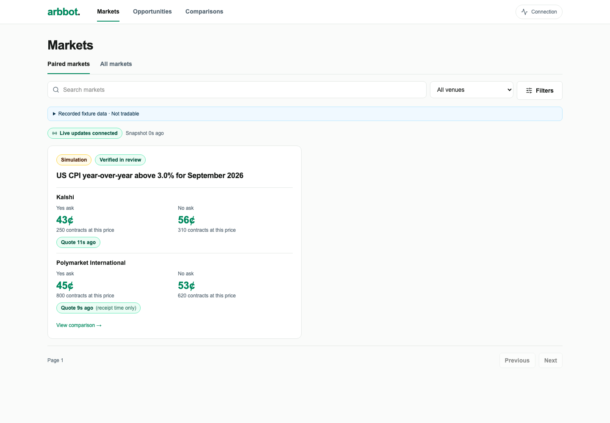
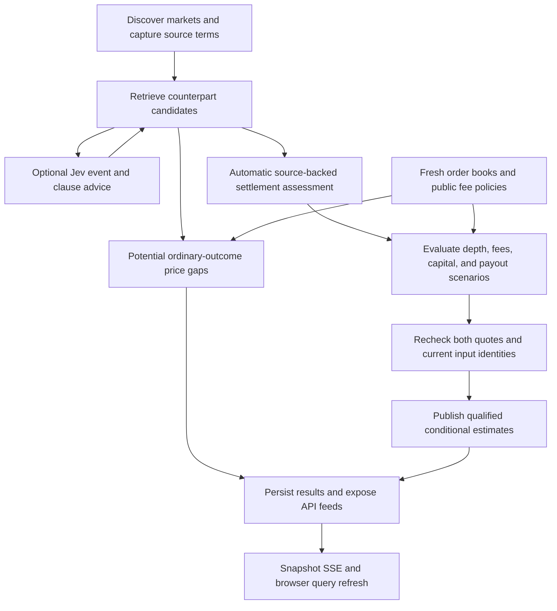

# Arbbot

**Prediction-market arbitrage discovery, from contract semantics to executable-depth calculations.**

Two markets can ask nearly the same question and still pay out differently.
Arbbot continuously discovers contracts across exchanges, compares their settlement evidence, and evaluates price differences using available order-book depth, fees, and conservative payout scenarios.
It brings the market-data pipeline, matching logic, financial engine, audit history, and web interface into one application.

The current integration focus is **Kalshi and Polymarket US**, with a separate Polymarket International adapter and research identity.
Public discovery runs without a connected trading account or mandatory human approval.
The project is under active development; real-contract qualification coverage and production operations remain unfinished.
It discovers conditional estimates and does not place trades.

[System design](docs/system-design.md) · [Roadmap](docs/implementation-roadmap.md) · [Development guide](docs/development.md)



*Current dashboard using development fixtures, including an International comparison and a recorded review badge. Prices and verification states are illustrative, not live findings or evidence of real-market equivalence.*

## Engineering highlights

- **Settlement-aware matching.** Compare event definitions, reporting periods, thresholds, resolution sources, cancellation, fallback, and ambiguity policies rather than equating similar titles.
- **Constrained model assistance.** Jev supplies typed event and clause findings grounded in captured evidence references; deterministic rules and financial checks retain authority.
- **Depth-aware economics.** Python `Decimal` calculations account for size, public fee policies, rounding, slippage reserves, order constraints, collateral, and worst-case supported settlement payouts.
- **Reproducible decisions.** Versioned terms, immutable source artifacts, book snapshots, model runs, assessments, and evaluation history retain the inputs behind a result.
- **Continuous, recoverable processing.** Independently supervised worker tasks use bounded queues, durable cursors, retries, backoff, caching, and input invalidation without tying ingestion to browser sessions.
- **Extensible venue boundaries.** Registered adapters and evidence, fee, and instrument capabilities support additional platforms without putting exchange-specific branches in the financial evaluator.
- **Typed backend-to-browser contracts.** FastAPI's OpenAPI schema generates the TypeScript client; financial values travel as exact decimal strings.

## From markets to opportunities



1. **Discover and normalize.** Traverse supported catalogs while preserving original terms, venue identifiers, native instrument semantics, and source/receipt timestamps. Catalog coverage and quote-monitoring budgets are separate.
2. **Find counterparts.** Use structured event identities and deterministic retrieval, supplemented by optional Jev suggestions for differently worded contracts. Title similarity alone does not establish equivalence.
3. **Qualify settlement evidence.** Versioned providers check applicable documents, supported definitions, clause conflicts, and exceptional outcomes. Unknown language and missing evidence produce explicit incomplete states.
4. **Calculate the economics.** Size complementary exposure against actual depth, apply supported costs and capital constraints, and evaluate the minimum payoff across modeled settlement scenarios.
5. **Publish and invalidate.** Recheck both books and exact input revisions before publishing qualified estimates. Changed terms, sources, fees, stale quotes, or venue failures can withdraw dependent results.

Semantic assessments are cached independently of price updates, so changing quotes do not require another model request or settlement interpretation.
Both result feeds are implemented in the backend:

| Feed | Meaning | Current interface |
| --- | --- | --- |
| Potential price gaps | Positive ordinary-outcome spreads supported by fresh depth; settlement or financial inputs may remain unresolved, with unknown costs kept nullable | `/api/v1/potential-opportunities`; dedicated browser view planned |
| Qualified estimates | Positive modeled worst-case net estimates supported by current automatic assessments, public fees, instrument constraints, and rechecked quotes | `/api/v1/opportunities` and existing opportunity screens |

Account eligibility, prefunded balances, borrowing, and account-specific charges remain disclosed assumptions.
Neither feed establishes atomic fills or guaranteed profit.

## Why Jev?

The integration uses **`typesafe/jev-1.13` through OpenRouter's Decisions API** to classify whether contracts describe the same event and whether supplied settlement clauses have the same meaning.
Typed choices include explicit insufficient-evidence outcomes.
The model selects supplied span IDs; the application reconstructs quotations from captured text rather than accepting invented quotations.

The interesting engineering decision is the model's boundary: it can surface candidates that deterministic wording comparisons miss, but its confidence cannot qualify settlement compatibility, invent missing evidence, or bypass financial gates.
Numerical thresholds, dates, rounding, and payout comparisons stay in Python.

The provider runs independently of book polling with a two-request-per-second limit, bounded concurrency, transient retries, durable jobs, and semantic caching.
Changed inputs invalidate current advice, and late responses remain audit history.
Missing credentials leave deterministic matching operational.
There is no daily spending cap; the provider key is optional and backend-only.

**An initial [live-provider benchmark](docs/contributing/jev-live-benchmark-2026-10-15.json) returned matching raw event labels on 30 of 30 recorded authentic pairs, but produced no additional candidates at the configured thresholds.**
Assisted retrieval stayed at 8 of 9 labeled counterparts; this small sample does not establish general accuracy, calibrated confidence, or settlement compatibility.
Scripted provider responses in integration tests exercise failure handling separately from these actual model results.
The [Jev guide](docs/jev-classification.md) documents evidence constraints, configuration, the benchmark, and recovery behavior.

## Architecture

A modular monolith with three runtime processes keeps the system integrated while separating responsibilities:

- **Web:** Next.js/React interface, same-origin API proxy, TanStack Query state, and snapshot-driven refresh.
- **API:** FastAPI/Pydantic reads for markets, comparisons, current results, evidence, health, and history, plus authenticated optional operator mutations.
- **Worker:** Persistent asyncio tasks for catalog discovery, sources, matching, Jev, qualification, books, fees, and evaluation.

PostgreSQL stores durable inputs, jobs, current pointers, and immutable history through SQLAlchemy and Alembic.
A PostgreSQL advisory lock currently permits one active ingestion worker per database; its supervised tasks run concurrently.
Redis and distributed workers are not part of the current deployment model.

| Layer | Technology |
| --- | --- |
| Web | Next.js, React, TypeScript, Tailwind CSS, shadcn-style primitives |
| Browser data | TanStack Query and Table, generated TypeScript API client, SSE |
| Backend | Python, FastAPI, Pydantic, asyncio, HTTPX, WebSocket clients |
| Persistence | PostgreSQL, SQLAlchemy, Alembic |
| Verification | pytest, Vitest, Playwright, recorded exchange/provider transports |
| Local infrastructure and diagnostics | Docker Compose, structured logs, API Prometheus metrics, opt-in OpenTelemetry tracing |

See the [system design](docs/system-design.md) for component ownership, cache identities, invalidation, failure isolation, venue extension, and scaling constraints.

## Run locally

Install Docker with Compose, then run from the repository root:

```sh
docker compose up --build -d
```

Open **<http://localhost:3000/opportunities>** for the simulated opportunity and **<http://localhost:8000/docs>** for interactive API documentation.
The default stack starts PostgreSQL, migrations, API, worker, and web in explicitly labeled **simulation mode** with synthetic contracts and a reproducible opportunity.
It requires no exchange or OpenRouter credentials.
Inspect its underlying quotes in [All markets](http://localhost:3000/markets?view=all); the minimal simulation fixture is not included by the default paired-market filter.
The screenshot above uses the separate frontend fixture mode, which provides a richer recorded UI dataset without a backend.

Verify the running simulation after the first worker cycle:

```sh
docker compose exec -T api python scripts/smoke.py
```

Inspect logs or stop the stack while retaining the database volume:

```sh
docker compose logs --tail=50 api worker
docker compose down
```

For **live public data**, stop the simulation stack first, then use the isolated US demo configuration:

```sh
docker compose -p arbbot-demo --env-file infra/demo.env up --build -d
```

This configuration polls Kalshi and Polymarket US, with broad catalog discovery and a monitoring budget of 20 contracts per venue.
It never falls back to simulation; unavailable or stale books remain explicit.
An empty qualified feed is expected when settlement evidence or supported interpretation is incomplete.
Live endpoint availability depends on the venues; see the [development guide](docs/development.md) for verification, optional Jev configuration, ports, and separate International streaming support.
Local Compose credentials are development defaults, not a production deployment configuration.

## Validation and current limits

The [October 15 implementation verification record](docs/contributing/automatic-qualification-acceptance-2026-10-14.json) reports **566 tests passing on each of SQLite and PostgreSQL**, **66 frontend unit tests**, and **66 desktop/mobile fixture browser tests**, plus supplemental source, pagination, financial, contract-generation, lint, type, and build checks.
These are recorded implementation results, not a claim that every check has been rerun for each documentation commit.
The subsequent [main consolidation checks](docs/contributing/branch-consolidation-handoff.md) passed 567 tests on each backend database, 66 frontend unit tests, all 66 desktop/mobile fixture tests, migrations/contracts, and the production build.

The automatic PostgreSQL/worker/API acceptance covers zero required human records, separate potential results, source-change invalidation, fee outage/recovery, continuing book polling, and worker restart.
Its positive examples use synthetic complete contracts and synthetic document bindings with recorded public fee documents.
Earlier connected browser acceptance covers the review-driven and Jev workflows; it does not establish completion of the new automatic browser flow.
Backend and frontend [CI definitions](.github/workflows) provide repeatable checks; historical passing runs do not establish the status of a newer commit.

Remaining work is explicit:

- **Authentic settlement coverage:** all 30 authentic Kalshi/US benchmark pairs currently remain incomplete for automatic settlement qualification. Complete interpretation uses a closed source-language grammar; general natural-language settlement understanding is not implemented.
- **Browser completion:** the separate potential feed and full automatic qualification inspection exist as APIs but await dedicated browser workflows.
- **Model evaluation:** the initial 30-pair live run showed no retrieval lift at current thresholds. Broader evaluation, uncertain event labels, and confidence calibration remain open.
- **Production operations:** production deployment, broader US streaming, measured production latency, backup/recovery rehearsal, and the forward paper study remain open.

## Explore the repository

| Resource | What to inspect |
| --- | --- |
| [System design](docs/system-design.md) | Architecture, data flow, correctness boundaries, and extension model |
| [Automatic qualification](docs/automatic-qualification.md) | Evidence rules, result feeds, scheduling, and authentic coverage limits |
| [Jev classification](docs/jev-classification.md) | Typed model decisions, captured evidence, provider resilience, and benchmark |
| [Financial engine](backend/arbbot/arbitrage/engine.py) | Depth-dependent sizing, costs, capital, and settlement payoff arithmetic |
| [Development guide](docs/development.md) | Local Python/web setup, tests, recorded acceptance, live demos, and generated contracts |
| [Backend operations](docs/backend.md) | Configuration, ingestion, persistence, and historical review tooling |
| [Implementation roadmap](docs/implementation-roadmap.md) | Delivered scope, next milestones, and acceptance criteria |
| [Contributing](CONTRIBUTING.md) | Contribution boundaries and engineering conventions |
