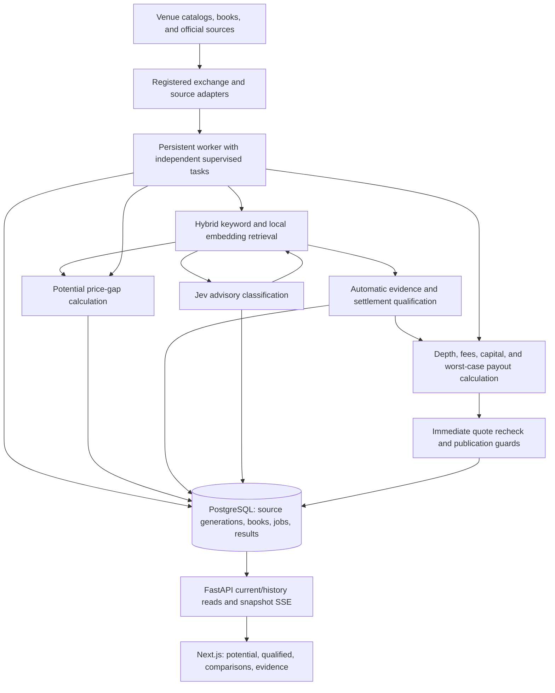

# System design

Updated October 15, 2026.
This is the product architecture for automatic, continuous prediction-market arbitrage discovery.
It describes the current component boundaries and identifies remaining delivery work explicitly.
Use the [roadmap](implementation-roadmap.md) for implementation order and [automatic qualification](automatic-qualification.md) for operational details.

## Product contract

A user opens the app, sees current cross-exchange price gaps and qualified conditional estimates, and can inspect the contracts, trade directions, costs, liquidity, freshness, and unresolved conditions.
Discovery and calculation run continuously without a browser session, human approval, or a connected trading account.
The initial strategy is two-leg complementary binary exposure on supported instruments.
The current venue priority is Kalshi and Polymarket US; Polymarket International retains its separate identity and research/access labeling.

Fast discovery requires separating cheap quote updates from slow semantic work.
Correct discovery requires distinguishing an ordinary-outcome price gap from a supported worst-case settlement estimate.
The system provides both, with explicit provenance and current validity.
Human reviews remain optional historical/operator functionality, and an explicit operator veto remains effective until cleared.
No component places orders, holds funds, or transfers money.

## Accepted candidate-visibility direction

The [candidate-visibility decision](decisions/candidate-visibility.md) is authoritative for subsequent matching and presentation work.
Every valid, fresh Jev `same_event` suggestion is visible as an Unverified match without minimum model-score admission thresholds.
Scores rank and explain suggestions; automatic settlement evidence alone grants Verified, explicit contradictions produce Mismatch, and positive current financial checks produce a separate arbitrage estimate.
Missing evidence and unavailable checks expose reasons without hiding the suggestion.
Verification is independent of profitability, and no human review is required.
Matching, APIs, monitoring, and browser views implement this policy without a model-score admission cutoff.
Historical benchmark thresholds describe prior behavior.

## Runtime architecture

Keep a modular monolith in one repository with separately runnable web, API, and persistent worker processes.
PostgreSQL is the durable source of truth.
The worker owns exchange/provider network traffic and background orchestration; API reads do not trigger external classification or exchange polling.
Next.js serves the browser and proxies same-origin API access; backend secrets never enter browser bundles.
Retain React/TypeScript, Tailwind/shadcn, and TanStack Query/Table in the web app; FastAPI/Pydantic, asyncio/HTTPX, SQLAlchemy/Alembic, and PostgreSQL in the backend.
Use the repository's pinned dependency files, generated OpenAPI client, pytest/Vitest/Playwright suites, and Docker Compose development environment.

The UI exposes Discoveries with filtered category coverage, excluded inventory, current and historical assessments, source inspection, and Jev evidence.
Opportunities separates Potential ordinary-outcome price gaps from Qualified conditional estimates.
There is one active ingestion worker per database, enforced by a PostgreSQL advisory lock.
Its tasks run concurrently within that process; adding worker replicas today does not increase ingestion throughput.
No Redis or external message broker is required for the current scheduling model.

## Responsibilities and extension boundaries

| Boundary | Current location | Responsibility |
| --- | --- | --- |
| Venue registration | `backend/arbbot/venues.py` | Stable identity, adapter factory, declared evaluation and evidence capabilities, access notes |
| Adapters and discovery | `exchanges/`, `discovery/` | Catalog traversal, source IDs, native prices/constraints, original terms, source relationships, explicit exclusions |
| Source evidence | `sources/` | Immutable captured artifacts, exact text, generations, retrieval failures, provenance |
| Scheduling and books | `workers/`, `ingestion/`, `streams/` | Independent schedules, monitoring budgets, complete-pair selection, valid snapshots, recovery |
| Candidate matching | `matching/` | Deterministic event identity, bounded retrieval, advisory Jev input/output and persistence |
| Automatic qualification | `qualification/` | Versioned interpretation, applicability, compatibility, payout models, assessment lifecycle, potential calculations |
| Financial evaluation | `arbitrage/`, `fees/` | Decimal sizing and payoff arithmetic, versioned public fee inputs, depth and instrument constraints |
| Publication | `execution/` | Configuration and quote rechecks, exact-input guards, durable publication and invalidation; no order submission |
| Storage and API | `storage/`, `api/` | Durable records, current/history projections, filtered pagination, sanitized status, SSE |
| Browser | `apps/web/` | Generated client, query cache, comparison and result presentation, evidence inspection |

Paths in the table are relative to `backend/arbbot/` except where fully specified.
Keep venue-specific parsing, source hosts, fee formulas, and native long/short behavior behind registered providers.
Keep shared event-family interpretation separate from venue transport.
The financial engine consumes normalized constraints and payout models, not exchange-name branches or network responses.
A new venue must declare unsupported capabilities explicitly and may begin with discovery-only support.
A test-only fourth venue already exercises generic qualification through API publication and invalidation.
Production adapters still require their own authentic evidence and capability tests.

## Two independent processing paths

### Semantic path

Catalog changes and captured source generations trigger deterministic counterpart retrieval, advisory classification, and automatic qualification.
Retrieval uses established event identities, existing reviewed pairs, title indexes, and a bounded nearby-date/category supplement.
Deduplicate pairs and disclose traversal and retrieval limits instead of implying exhaustive all-pairs comparison.
Explicit event, reference-period, season, or contract-definition contradictions cannot be overridden by title similarity or model confidence to obtain verification.
Under the accepted visibility policy, retain a conflicting suggestion and its evidence as Mismatch rather than silently hiding it.

Jev evaluates event identity and clause meaning from supplied public metadata and captured span IDs.
It can add a candidate that title retrieval would exclude, but does not create a settlement model or grant qualification.
Separate clause questions cover outcomes, resolution sources, cancellation, fallback, ambiguity, and revisions.
Python retains numerical thresholds, dates, rounding, and payout comparisons.
Model-selected evidence resolves to captured quotations; source text is data, never instructions.

Automatic qualification uses versioned evidence and family providers to establish applicable terms, complete supported definitions, and exceptional policy coverage.
Unknown language, missing applicability, unsupported payouts, and incomplete policy inventories remain explicit blockers.
Identical wording does not prove that both venues must cancel or resolve exceptionally together.
Enumerate supported independent joint outcomes conservatively and retain their minimum combined payout.

The current complete interpreter uses a closed explicit source-language grammar, with limited natural-language family identity extractors.
All 30 authentic benchmark pairs remain incomplete; extending authentic source applicability and interpretation is the primary coverage task.
This limitation must remain visible in release notes and product coverage metrics.

### Price path

The target price path updates only affected monitored pairs on a book refresh and reuses current semantic assessments.
Slow source capture and Jev requests must not hold the book-polling schedule or require semantic recomputation for every tick.
The implementation already separates supervised tasks; broader streaming and measured low-latency publication remain roadmap work.

Calculate potential gaps when a fresh established event or qualifying advisory suggestion and valid depth support complementary ordinary-outcome exposure.
Retain settlement blockers and nullable cost/capital values when required inputs are missing.
Do not sum unsupported currencies or turn an unknown fee into zero.

For a qualified estimate, combine a current assessment with current public fee policies, native instrument constraints, order-book depth, rounding, slippage reserve, capital limits, and minimum sizes.
Keep US native short proceeds, gross collateral, buying power, and acquisition cost distinct.
Immediately recheck both legs before publication and bind the result to the exact input revisions used.
A changed quote, source, assessment, fee policy, instrument constraint, veto, or exchange-health state can withdraw an estimate.
A semantic qualification can remain valid while a price result expires or becomes unprofitable.

## Result and state contracts

| Result | What it establishes | What it does not establish |
| --- | --- | --- |
| Candidate pair | A retrieved possible counterpart, with deterministic or advisory rationale | Settlement equivalence |
| Jev same-event suggestion | Target: any valid fresh same-event finding is visible as Unverified; current code still requires configured candidate thresholds | Measured accuracy, qualification, or profitability |
| Potential price gap | Fresh depth and a positive gross ordinary-outcome spread, with known costs where available | Complete exceptional payouts or executable arbitrage |
| Automatic qualification | Supported compatible source-backed settlement definitions and payout scenarios | Positive economics, available balances, or guaranteed execution |
| Qualified estimate | Positive modeled worst-case net result after supported costs and fresh quote rechecks | Atomic fills, account eligibility, or realized profit |

Qualification lifecycle states are `pending`, `qualified`, `incomplete`, `incompatible`, `stale`, and `unavailable`.
Jev has its own lifecycle, including unconfigured and disabled states.
Venue health, model availability, qualification completeness, and quote freshness are separate dimensions.
A Jev outage cannot imply an exchange-book outage, and a healthy SSE connection cannot imply fresh quotes.
Unconfigured Jev leaves deterministic discovery operational.

`GET /api/v1/potential-opportunities` and `GET /api/v1/opportunities` remain separate public contracts.
Qualification current/history endpoints and the classification endpoint explain their distinct evidence bases.
Revalidate current eligibility and apply filtering/ranking before pagination.
Historical access must identify stale or withdrawn records and never silently restore them to current feeds.

## Persistence and invalidation

Persist normalized markets alongside source IDs, original terms, source/receipt timestamps, and instrument semantics.
Preserve immutable source artifacts and shared document generations, book snapshots, versioned fee policies, classifications, assessments, settlement models, evaluations, and publication history.
Store mutable current pointers and durable jobs separately from immutable audit records.
Persist enough inputs to reproduce both the settlement decision and the financial calculation.
Use PostgreSQL NUMERIC and Python Decimal for money; expose exact decimal strings to TypeScript.

Semantic cache identities include the pair, relevant terms, document generations/status, applicability, and provider/policy/question versions.
Classification also binds requested model identity; qualification binds explicit vetoes and the exact settlement model.
Quote, balance, fee, and unchanged receipt updates do not trigger semantic recomputation.
Fees and quotes have independent financial validity checks.
Cache successful semantic results for no more than 24 hours, with qualification further bounded by source validity and market close.
Current reads and publication recheck semantic identity; late results remain audit history without becoming current.
Changed or unavailable shared documents invalidate all dependent assessments.

Keep migrations additive and historical review payloads readable.
The automatic path does not fabricate human reviewer identities or approval records.
Optional operator mutation APIs remain authenticated and revision-aware.

## Scheduling, limits, and failure isolation

Discovery, sources, matching, Jev, qualification, fees, books, and evaluation have independently supervised schedules.
Coalesce repeated work and wake matching through existing in-process notifications after semantic completion.
Durable cursors rotate catalog work beyond bounded queues.
The classification and qualification queues each bound pending/running work to 512 pairs, with four concurrent tasks each.
Qualification uses recoverable leases; restart recovery must not lose pending work or publish stale responses.

Retain monitoring priority for qualified/verified relationships, established events, watchlists, then fresh AI suggestions and other candidates, with rotation within tiers.
Measure starvation across tiers and make monitoring budget/coverage visible.
Do not poll one leg indefinitely while presenting its counterpart as current.

Jev uses OpenRouter Decisions with pinned `typesafe/jev-1.13`, two attempts per second shared across requests and retries, four concurrent requests, ten-second timeouts, and at most three attempts for transient failures.
Respect shared backoff and `Retry-After`; authentication or unsupported-model failures pause provider calls until configuration is corrected.
There is no daily spending cap.
Requests are bounded to 24 KiB, with missing context disclosed.
See [Jev configuration](jev-classification.md) for exact settings and operational recovery.

Book integrity failures discard affected usable state and require resynchronization.
Source and fee failures withdraw dependent estimates while independent venues and book polling continue.
Public errors use sanitized codes and never expose keys, headers, or provider response bodies.
Simulation, recorded responses, and live data must remain explicitly labeled and isolated.
Recorded transports have no network fallback.

## Browser experience and latency

The target landing experience offers Potential and Qualified views with shareable venue/category/search filters and stable pagination.
Cards show the event, venues, directions, observed depth, gross spread or qualified net estimate, capital when known, freshness, and the leading unresolved condition.
Do not label ordinary-outcome spreads as qualified profit, convert null costs into zero, or describe model scores as accuracy.
Provide progressive disclosure for source documents, clause comparisons, payout scenarios, calculation inputs, assumptions, and history.
Inspection never requires entering a review workflow.

Snapshot SSE invalidates existing TanStack Query reads; the browser then fetches current authoritative results through the generated client.
Preserve selection and navigation during refresh, and expose stale/reconnecting/error states without hiding why a result disappeared.
Display data origin and venue identity on both desktop and mobile.
The new potential and qualification screens remain unimplemented and are the next UI delivery scope.

The initial performance target is p95 of two seconds for warm stored-book potential publication and assessment-completion-to-publication under a declared workload.
Existing recorded assertions exercise these warm boundaries only.
Cold discovery, external source capture, queue wait, Jev time, API latency, and browser render must be measured separately.
No production end-to-end latency guarantee has been established.
Add stage timings, queue age, monitored-pair coverage, stale-book rates, withdrawal reasons, and provider failure counts before tuning concurrency or polling budgets.

## Scale and operational validation

Start by measuring database query cost, event coalescing, pair fan-out, queue saturation, and provider limits within the current single-worker design.
Scale API reads independently where supported, and improve indexed current-result projections before adding distributed infrastructure.
If measured ingestion demand exceeds one worker, introduce explicit ownership/leases and partition by venue or event family, with idempotent jobs and cross-partition pair notifications.
Replace the global worker lock only alongside that ownership model and restart/failure tests.
Redis or a broker is justified only by a measured coordination need; durable truth remains in PostgreSQL.

Validate pure settlement and Decimal calculations separately from recorded provider transports, persistence/migrations, and full worker/API/browser flows.
Authentic labeled corpora measure coverage and errors; synthetic fixtures test controlled edge cases and cannot establish real-market accuracy.
A confidently wrong model response must fail to bypass qualification and financial checks.
Require outage/recovery, source amendment, late-response, stale-quote, restart, pagination, and multi-venue extension tests.
Finish staging secrets, operator authentication, tracing/metrics, backup restore, and a seven-day forward paper study before claiming production readiness.
